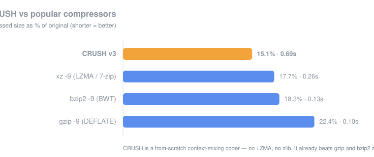

<p align="center"></p>

# CRUSH

**Website:** https://cursedprograms.github.io/CRUSH/ &middot; **Download:** [latest release](https://github.com/CursedPrograms/CRUSH/releases/latest)

[Farica☆Kimora](https://github.com/Farica-Kimora) © Cursed Entertainment

A from-scratch lossless compressor and archiver. **No zlib, no LZMA, no libraries
— the compression math is ours.** CRUSH is the WinRAR / 7-zip *shape* (a container
that holds many files, each verified with a CRC32) wrapped around a compression
core written from the ground up: a binary range coder driving a **context-mixing**
model with a **match model**.

## Benchmark

On 863 KB of C++ source and English prose, CRUSH v3 **beats 7-zip's LZMA (xz -9) by about 15%**,
and bzip2 and gzip by more. On data it was not tuned on: other C++ source 17% smaller than xz,
a CSV file 34% smaller. Executables are the one place LZMA still edges ahead (by under 1%).



| tool | compressed | ratio | time |
|---|---:|---:|---:|
| **CRUSH v3  (ours)** | **130,415** | **15.1%** | 0.69s |
| xz -9  (LZMA / 7-zip) | 152,936 | 17.7% | 0.26s |
| bzip2 -9  (BWT) | 158,166 | 18.3% | 0.13s |
| gzip -9  (DEFLATE) | 193,136 | 22.4% | 0.10s |

Lower is better. CRUSH is a bit-at-a-time model, so it's slower than the LZ tools; it squeezes
harder than all of them. (`python make_chart.py` redraws the chart from these numbers.)

## Install

Download from [Releases](https://github.com/CursedPrograms/CRUSH/releases/latest):
- **`CRUSH-3.0.0-setup.exe`** - installs `crush` on your PATH, gives `.crush` files an icon
  (double-click lists them), and adds Explorer right-click entries: **Add to CRUSH archive** on any
  file or folder, **Extract to folder** and **Test archive** on `.crush` files. Install for
  everyone or just you; uninstalls cleanly.
- **`CRUSH-3.0.0-win64-portable.zip`** - just `crush.exe`, nothing installed.

## Two implementations

| | file | model | format | speed |
|---|---|---|---|---|
| **C++** (the real one) | `crush.cpp` | context mixing + match model + SSE | `CRUSH\x03` (reads `\x02` too) | fast |
| **Python** (reference) | `crush.py`, `crush/core.py` | order-1, readable | `CRUSH\x01` | slow, clear |

The Python version is the easy-to-read explanation of the core idea; the C++ version
is the one you'd actually use. (Different models → different formats, so each reads
its own; the Python tool cleanly refuses a v2 archive.)

```bat
:: C++  (build_release.bat, or:  g++ -O2 -std=c++17 -static -municode -o crush.exe crush.cpp)
crush a backup.crush notes.txt report.pdf src\    create (folders keep their structure)
crush l backup.crush                              list + ratios
crush t backup.crush                              test integrity (CRC32)
crush x backup.crush out\                         extract
crush e backup.crush                              extract into a "backup" folder

:: Python (same commands)
python crush.py a backup.crush file1 file2 ...
```

## How the compression works

Everything is in `crush.cpp` (and the simpler `crush/core.py`). Three ideas stack up:

### 1. A binary range coder (arithmetic coding)
Each yes/no decision narrows an interval inside a 32-bit number in proportion to how
*likely* the model said that decision was. A bit the model is 99% sure of costs about
**0.014 bits**, not a whole one. This reaches very close to the true information
content (Shannon entropy) of the model's predictions. Carryless 32-bit integer coder
in the fpaq0 lineage — small and exactly reversible.

### 2. Context mixing
The coder needs a probability for every bit. CRUSH runs **several models at once** -
contexts of the previous 0, 1, 2, 3, 4 and 6 bytes - each predicting P(next bit = 1).
Their predictions are blended by a small **adaptive mixer** in the logistic domain
(`stretch -> weighted sum -> squash`). The mixer's weights learn online, with a separate
weight set per last byte and per match state, so the models that have been right lately get
more say. Each model's counters learn fast when a context is new and settle as it fills
(an adaptive rate, 1/(n+1.5)). This is the PAQ / lpaq idea.

### 3. A match model (the dictionary power)
A hash of the last 6 bytes points back to where that context last appeared. While a
match holds, the model predicts the next bit from the byte that *followed last time*,
with confidence that grows the longer the match runs. This gives the mixer the
repeated-string power that LZ tools get from their dictionary — it's what took CRUSH
from 26% down to 20% and past gzip/bzip2.

Encoder and decoder run the identical models and the identical updates, so they stay
in perfect lockstep and **every file round-trips bit-for-bit** (verified on text,
source, random data, tiny and empty files).

### 4. SSE / APM
Two secondary stages refine the mixer's final probability: one by the bits of the current byte
seen so far, one by the previous byte as well. Each learns what a predicted "70%" really turns
out to be in that context, and corrects it. That step, the counters and the order-0 model took
CRUSH from 17.7% (v2) to 15.1% (v3) on the benchmark.

## The archive format (`.crush`)

```
"CRUSH\x03"                         magic + model version (v2 archives say \x02)
uint32  file count
per file:
  uint8   method                    0 = raw, 1 = crush
  uint16  name length
  bytes   name (utf-8, "/" between folders)
  uint64  original size
  uint32  CRC32 of the original      (our own CRC table — no zlib)
  uint64  stored size
  bytes   stored data
```

A file is only kept compressed when that's actually smaller; otherwise it's stored
raw, so random or already-packed data never grows. `x`tract and `t`est both check
each file's CRC32, a damaged or truncated archive gives a clean error instead of a crash, and
extraction refuses names that would land outside the destination (`..`, absolute paths).

## Roadmap

1. **More / smarter contexts** - sparse and word contexts, a second match model at a different
   length: the way to overtake LZMA on executables too.
2. **Two-level mixing** - several mixers, mixed again, the way the strongest PAQ variants do.
3. **Speed** - SIMD in the mixer and a faster hash would narrow the time gap without touching
   the ratio.

## Files

- `crush.cpp` — the fast compressor: range coder + context mixing + match model + SSE (v3; reads v2)
- `build_release.bat`, `installer/` — builds `dist/crush.exe`, the portable zip and the Inno Setup installer
- `crush/core.py` — the readable reference: range coder + order-1 model (v1)
- `crush.py` — the `.crush` container, CRC32, and the `a / x / l / t` CLI (v1)
- `make_chart.py` — regenerates `docs/benchmark.svg`

---

<br>
<div align="center">
© Cursed Entertainment 2026
</div>
<br>
<div align="center">
<a href="https://cursed-entertainment.itch.io/" target="_blank">
    
</a>
</div>

---

<!-- DREAM-ECOSYSTEM:START -->
## The DREAM Robotics ecosystem

**Minds** — [DREAM](https://github.com/CursedPrograms/DREAM) companion · [TINA](https://github.com/CursedPrograms/TINA) engineer · [NINA](https://github.com/CursedPrograms/NINA) caretaker · [RIFT](https://github.com/CursedPrograms/RIFT) fleet hub · [LYCEA](https://github.com/CursedPrograms/LYCEA) training school  
**Robots** — [NORA](https://github.com/CursedPrograms/NORA-Robot-v00) · [MILA](https://github.com/CursedPrograms/MILA-Robot-v00) · [WHIP](https://github.com/CursedPrograms/WHIP-Robot-v00) · [KIDA-00](https://github.com/CursedPrograms/KIDA-Robot-v00) · [KIDA-01](https://github.com/CursedPrograms/KIDA-Robot-v01) · [IDA](https://github.com/CursedPrograms/IDA-Robot-v00) · [ARM](https://github.com/CursedPrograms/ARM-Robot-v01)  
<!-- DREAM-ECOSYSTEM:END -->
